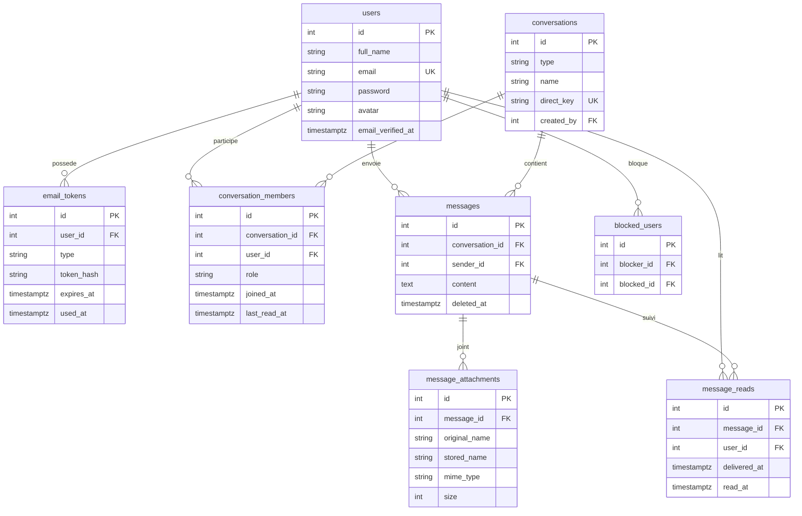

<p align="center">
  
</p>

<h1 align="center">Kadea Chat</h1>

<p align="center">
  Application web de messagerie pour les étudiants de Kadea Academy.<br />
  Conversations privées, groupes, temps réel, présence et gestion du profil.
</p>

- **Auteur** : David Mbiya
- **Dépôt** : https://github.com/david28804/kadea-chat
- **Application en ligne** : _à compléter après le déploiement_
- **Maquette** : https://claude.ai/artifact/6cmtmK7UXpceCwtgAMsC45

## Sommaire

1. [Fonctionnalités](#fonctionnalités)
2. [Technologies](#technologies)
3. [Installation en local](#installation-en-local)
4. [Variables d'environnement](#variables-denvironnement)
5. [Schéma de base de données](#schéma-de-base-de-données)
6. [Structure du projet](#structure-du-projet)
7. [Sécurité](#sécurité)
8. [Déploiement](#déploiement)
9. [État d'avancement](#état-davancement)

## Fonctionnalités

**Authentification**
- Inscription, confirmation de l'adresse e-mail par lien, connexion, déconnexion
- Mot de passe oublié et réinitialisation par e-mail
- Pages protégées : seul un utilisateur connecté accède aux conversations

**Messagerie**
- Conversations privées (une seule par paire d'utilisateurs) et groupes
- Messages en temps réel (Server-Sent Events via Transmit)
- Compteur de messages non lus, filtres Toutes / Non lues / Groupes
- Suppression de ses propres messages
- Indicateur « en train d'écrire » et présence en ligne
- Blocage / déblocage d'un utilisateur

**Profil**
- Modification du nom et du mot de passe
- Photo de profil avec recadrage circulaire
- Thème clair / sombre aux couleurs de Kadea (rouge, blanc, noir)

## Technologies

| Domaine | Outil |
| --- | --- |
| Framework | AdonisJS 7 (kit Hypermedia) |
| Templates | Edge + Alpine.js |
| Base de données | PostgreSQL + Lucid ORM |
| Validation | VineJS |
| Temps réel | Transmit (SSE) |
| E-mails | Mailtrap (développement) |
| Assets | Vite |

## Installation en local

**Prérequis** : Node.js 20+, PostgreSQL, Git, un compte Mailtrap (gratuit).

```bash
git clone https://github.com/david28804/kadea-chat.git
cd kadea-chat
npm install
cp .env.example .env
node ace generate:key
```

1. Créez la base de données PostgreSQL : `CREATE DATABASE kadea_chat;`
2. Renseignez `.env` (voir le tableau ci-dessous).
3. Lancez les migrations puis le serveur :

```bash
node ace migration:run
mkdir -p public/uploads/avatars
npm run dev
```

L'application est disponible sur http://localhost:3333.

> **Tester le temps réel** : deux fenêtres du même navigateur partagent la session.
> Utilisez deux navigateurs différents (ex. Opera et Edge) ou une fenêtre privée.

## Variables d'environnement

| Variable | Rôle |
| --- | --- |
| `NODE_ENV`, `PORT`, `HOST` | Mode et adresse du serveur |
| `APP_KEY` | Clé secrète (générée par `node ace generate:key`) |
| `APP_URL` | URL publique, utilisée dans les liens des e-mails |
| `DB_HOST`, `DB_PORT`, `DB_USER`, `DB_PASSWORD`, `DB_DATABASE` | Connexion PostgreSQL |
| `SESSION_DRIVER` | Stockage des sessions |
| `SMTP_HOST`, `SMTP_PORT`, `SMTP_USERNAME`, `SMTP_PASSWORD` | Serveur d'envoi d'e-mails |

Le fichier `.env` n'est jamais versionné ; `.env.example` sert de modèle.

## Schéma de base de données



| Table | Rôle |
| --- | --- |
| `users` | Comptes ; `email_verified_at` vide tant que l'e-mail n'est pas confirmé |
| `email_tokens` | Jetons de confirmation (24 h) et de réinitialisation (1 h), stockés hachés (SHA-256), à usage unique |
| `conversations` | Privées ou groupes ; `direct_key` (`min-max` des ids) évite les doublons en privé |
| `conversation_members` | Membres d'une conversation ; `last_read_at` sert au compteur de non lus |
| `messages` | Messages ; suppression logique via `deleted_at` |
| `message_attachments` | Fichiers joints (table prête, fonctionnalité à venir) |
| `message_reads` | Statuts reçu / lu (table prête, fonctionnalité à venir) |
| `blocked_users` | Relations de blocage |

## Structure du projet

```
app/
  controllers/   session, comptes, e-mails, conversations, messages, groupes, blocages, profil, présence
  models/        modèles Lucid et relations
  services/      email_token_service, presence_service
  validators/     règles de validation VineJS
database/
  migrations/    8 tables
resources/
  css/app.css    thème Kadea (clair / sombre)
  js/            realtime, chat, présence, recadrage d'avatar
  views/         layouts, composants et pages Edge
start/
  routes.ts      routes et middlewares
  transmit.ts    autorisations des canaux temps réel
public/
  logo/          logos SVG
  uploads/       avatars (non versionné)
```

## Sécurité

- Mots de passe hachés, sessions par cookie, protection CSRF (Shield)
- Jetons d'e-mail hachés, expirants et à usage unique
- Accès aux conversations réservé à leurs membres ; canaux temps réel autorisés côté serveur
- Envoi de fichiers validé (taille, extension, signature réelle du fichier)
- Requêtes SQL paramétrées (Lucid) et échappement automatique d'Edge contre le XSS
- Secrets uniquement dans `.env`, exclu de Git

## Déploiement

_À compléter après la mise en ligne._ Points d'attention :

- Remplacer Mailtrap par un vrai service SMTP (Resend, Brevo…)
- Définir `APP_URL` sur l'adresse publique et générer une nouvelle `APP_KEY`
- Utiliser une base PostgreSQL hébergée, puis `node ace migration:run`
- Prévoir un stockage persistant pour `public/uploads/`
- La présence en ligne est gardée en mémoire : une seule instance du serveur

## État d'avancement

| Élément | État |
| --- | --- |
| Inscription, confirmation e-mail, connexion, réinitialisation | Terminé |
| Conversations privées et groupes | Terminé |
| Messages en temps réel, non lus, suppression | Terminé |
| Présence en ligne et indicateur de saisie | Terminé |
| Blocage d'utilisateurs | Terminé |
| Profil, photo recadrée, thème Kadea | Terminé |
| Statuts envoyé / reçu / lu | À faire |
| Partage de fichiers et d'images | À faire |
| Gestion de groupe (ajout, retrait, quitter) | À faire |
| Recherche dans une conversation (interface) | À faire |
| Déploiement | À faire |
