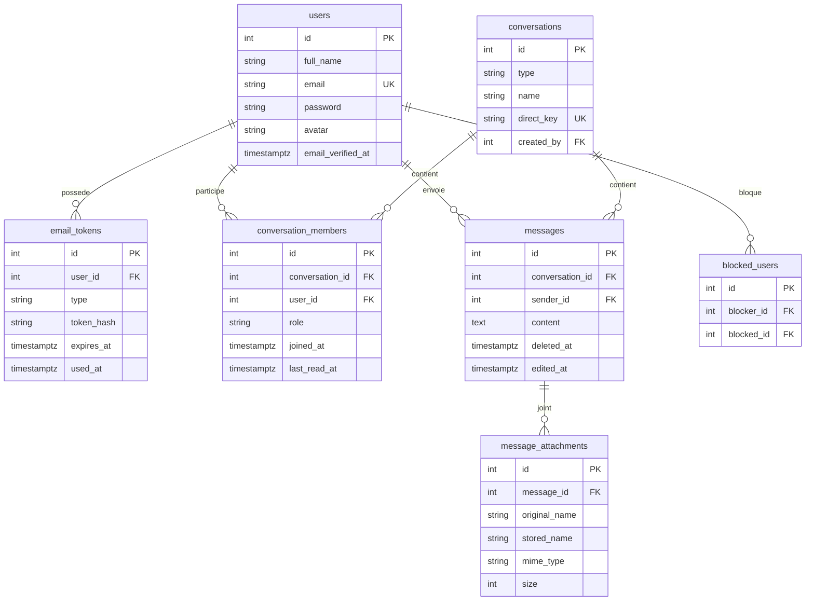

<h1 align="center">Kadea Chat*</h1>

<p align="center">
  Application web de messagerie pour les étudiants de Kadea Academy.<br />
  Conversations privées, groupes, temps réel, recherche, présence et gestion du profil.
</p>

- **Auteur** : David Mbiya
- **Dépôt** : https://github.com/david28804/kadea-chat
- **Application en ligne** : _à compléter après le déploiement_
- **Maquette** : https://claude.ai/artifact/6cmtmK7UXpceCwtgAMsC45

## Sommaire

1. [Fonctionnalités](#fonctionnalités)
2. [Technologies](#technologies)
3. [Installation en local](#installation-en-local)
4. [Tests](#tests)
5. [Variables d'environnement](#variables-denvironnement)
6. [Schéma de base de données](#schéma-de-base-de-données)
7. [Structure du projet](#structure-du-projet)
8. [Sécurité](#sécurité)
9. [Déploiement](#déploiement)
10. [État d'avancement](#état-davancement)

## Fonctionnalités

**Accueil et authentification**
- Page d'accueil qui présente l'application, avec menu burger sur téléphone
- Inscription, confirmation de l'adresse e-mail par lien, connexion, déconnexion
- Mot de passe oublié et réinitialisation par e-mail
- Pages protégées : seul un utilisateur connecté accède aux conversations

**Conversations**
- Conversations privées (une seule par paire d'utilisateurs) et groupes
- Fenêtre « Nouveau » : démarrer une conversation ou créer un groupe sans quitter la page
- Messages en temps réel (Server-Sent Events via Transmit)
- Statuts des messages : envoyé, reçu, lu
- Partage de fichiers et d'images (5 Mo maximum)
- Compteur de messages non lus, filtres Toutes / Non lues / Groupes
- Modification et suppression de ses propres messages (actions au survol sur ordinateur, au toucher sur téléphone) ; un message modifié porte la mention « modifié »
- Indicateur « en train d'écrire » et présence en ligne
- Blocage / déblocage d'un utilisateur

**Groupes**
- Le créateur du groupe en est l'administrateur
- Un administrateur ajoute et retire des membres
- Chacun peut quitter un groupe ; si le dernier administrateur part, le membre le plus ancien le devient ; le groupe disparaît quand le dernier membre part

**Recherche**
- Barre de recherche de la liste : trouve les conversations par leur nom et les messages qui contiennent le mot tapé, dans toutes ses conversations
- Recherche dans une conversation : les messages se filtrent pendant la frappe, le mot est surligné ; Entrée cherche dans tout l'historique

**Profil et apparence**
- Modification du nom et du mot de passe
- Photo de profil avec recadrage circulaire
- Thème crème et noir, en mode sombre (par défaut) ou clair, mémorisé pour tout le site

## Technologies

| Domaine | Outil |
| --- | --- |
| Framework | AdonisJS 7 (kit Hypermedia) |
| Templates | Edge + Alpine.js |
| Base de données | PostgreSQL + Lucid ORM |
| Validation | VineJS |
| Temps réel | Transmit (SSE) |
| E-mails | Brevo (API), ou Mailtrap en SMTP pour le développement |
| Tests | Japa (tests fonctionnels avec client HTTP) |
| Assets | Vite |
| Polices | Inter Tight et Instrument Serif (Google Fonts) |

## Installation en local

**Prérequis** : Node.js 24+, PostgreSQL, Git, un compte Brevo ou Mailtrap (gratuits).

```bash
git clone https://github.com/david28804/kadea-chat.git
cd kadea-chat
npm install
cp .env.example .env
node ace generate:key
```

1. Créez la base de données PostgreSQL : `CREATE DATABASE kadea_chat;`
2. Renseignez `.env` (voir le tableau ci-dessous).
3. Lancez les migrations puis le serveur :

```bash
node ace migration:run
npm run dev
```

L'application est disponible sur http://localhost:3333.

Les dossiers des fichiers envoyés (`public/uploads/` pour les photos de profil,
`storage/uploads/` pour les pièces jointes) existent déjà dans le dépôt ; leur contenu n'est jamais versionné.

> **Tester le temps réel** : deux fenêtres du même navigateur partagent la session.
> Utilisez deux navigateurs différents (ex. Opera et Edge) ou une fenêtre privée.

## Tests

Les tests utilisent une base séparée, `kadea_chat_test` (réglée dans `.env.test`), qui est
recréée à partir des migrations à chaque lancement. Votre base de développement n'est jamais touchée.

```bash
# Une seule fois : créer la base de test
psql -U postgres -c "CREATE DATABASE kadea_chat_test;"

# Lancer les tests
node ace test
```

| Fichier | Ce qui est vérifié |
| --- | --- |
| `tests/functional/auth.spec.ts` | Inscription et envoi de l'e-mail, connexion refusée sans e-mail confirmé, connexion, mauvais mot de passe, pages protégées, déconnexion |
| `tests/functional/conversations.spec.ts` | Accès et écriture refusés aux non-membres, une seule conversation privée par paire, recherche de messages limitée à ses conversations, recherche dans une conversation, modification réservée à l'auteur |
| `tests/functional/groups.spec.ts` | Création, ajout et retrait réservés aux administrateurs, passage du rôle d'administrateur, suppression du groupe vide |

Les tests peuvent tourner pendant que `npm run dev` est lancé : ils ont leur propre cache Vite.

## Variables d'environnement

| Variable | Rôle |
| --- | --- |
| `NODE_ENV`, `PORT`, `HOST` | Mode et adresse du serveur |
| `APP_KEY` | Clé secrète (générée par `node ace generate:key`) |
| `APP_URL` | URL publique, utilisée dans les liens des e-mails |
| `DB_HOST`, `DB_PORT`, `DB_USER`, `DB_PASSWORD`, `DB_DATABASE` | Connexion PostgreSQL |
| `SESSION_DRIVER` | Stockage des sessions |
| `MAIL_MAILER` | `brevo` (API Brevo) ou `smtp` (Mailtrap ou autre serveur SMTP) |
| `MAIL_FROM_NAME`, `MAIL_FROM_ADDRESS` | Expéditeur des e-mails (avec Brevo, l'adresse doit être validée dans le compte Brevo) |
| `BREVO_API_KEY` | Clé API Brevo, utilisée quand `MAIL_MAILER=brevo` |
| `SMTP_HOST`, `SMTP_PORT`, `SMTP_USERNAME`, `SMTP_PASSWORD` | Serveur SMTP, utilisé quand `MAIL_MAILER=smtp` |

Le fichier `.env` n'est jamais versionné ; `.env.example` sert de modèle.

## Schéma de base de données



| Table | Rôle |
| --- | --- |
| `users` | Comptes ; `email_verified_at` vide tant que l'e-mail n'est pas confirmé |
| `email_tokens` | Jetons de confirmation (24 h) et de réinitialisation (1 h), stockés hachés (SHA-256), à usage unique |
| `conversations` | Privées ou groupes ; `direct_key` (`min-max` des ids) évite les doublons en privé |
| `conversation_members` | Membres d'une conversation ; `role` (`admin` / `member`) pour les groupes ; `last_read_at` sert au compteur de non lus et aux statuts reçu / lu |
| `messages` | Messages ; suppression logique via `deleted_at`, date de modification dans `edited_at` |
| `message_attachments` | Fichiers joints (images et documents, 5 Mo maximum) |
| `blocked_users` | Relations de blocage |

Une table `message_reads` a existé au début du projet ; elle n'a jamais servi et une migration la supprime.

## Structure du projet

```
app/
  controllers/   session, comptes, e-mails, conversations, messages, groupes, blocages, profil, présence
  models/        modèles Lucid et relations
  services/      email_token_service, presence_service
  validators/    règles de validation VineJS
database/
  migrations/    tables de l'application
  schema.ts      classes de schéma générées par Lucid
resources/
  css/app.css    thème Kadea (crème et noir, sombre / clair)
  js/            realtime, chat (messages, recherche), présence, recadrage d'avatar, accueil
  views/         layouts, composants et pages Edge
start/
  routes.ts      routes et middlewares
  transmit.ts    autorisations des canaux temps réel
tests/
  functional/    tests de l'authentification, des conversations et des groupes
  helpers.ts     création de comptes, conversations et messages pour les tests
public/uploads/  photos de profil (contenu non versionné)
storage/uploads/ pièces jointes (contenu non versionné)
```

## Sécurité

- Mots de passe hachés, sessions par cookie, protection CSRF (Shield)
- Jetons d'e-mail hachés, expirants et à usage unique
- Accès aux conversations réservé à leurs membres ; canaux temps réel autorisés côté serveur
- Gestion des groupes réservée aux administrateurs, vérifiée côté serveur
- La recherche de messages ne porte que sur les conversations de la personne connectée
- Envoi de fichiers validé (taille, extension, signature réelle du fichier)
- Requêtes SQL paramétrées (Lucid) et échappement automatique d'Edge contre le XSS ;
  le surlignage des recherches construit le texte sans `innerHTML`
- Secrets uniquement dans `.env`, exclu de Git ; fichiers des utilisateurs exclus de Git

## Déploiement

_À compléter après la mise en ligne._ Points d'attention :

- Mettre `MAIL_MAILER=brevo` et `BREVO_API_KEY` dans les variables du serveur
- Définir `APP_URL` sur l'adresse publique et générer une nouvelle `APP_KEY`
- Utiliser une base PostgreSQL hébergée, puis `node ace migration:run`
- Prévoir un stockage persistant pour `public/uploads/` et `storage/uploads/`
- La présence en ligne est gardée en mémoire : une seule instance du serveur

## État d'avancement

| Élément | État |
| --- | --- |
| Page d'accueil | Terminé |
| Inscription, confirmation e-mail, connexion, réinitialisation | Terminé |
| Conversations privées et groupes | Terminé |
| Messages en temps réel, non lus, modification, suppression | Terminé |
| Statuts envoyé / reçu / lu | Terminé |
| Partage de fichiers et d'images | Terminé |
| Présence en ligne et indicateur de saisie | Terminé |
| Blocage d'utilisateurs | Terminé |
| Gestion de groupe (ajout, retrait, quitter) | Terminé |
| Recherche (liste et conversation) | Terminé |
| Profil, photo recadrée, thème sombre / clair | Terminé |
| Tests automatiques | Terminé |
| Déploiement | À faire |
